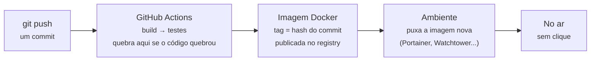

# Atividade extra: CI/CD com GitHub Actions — Allan Siriani

**Fonte:** https://lapps.studio/disciplinas/introducao-computacao-nuvem/atividades/ci-cd-github-actions/

[disciplinas](https://lapps.studio/) / [introdução à computação em nuvem](https://lapps.studio/disciplinas/introducao-computacao-nuvem/) / [atividades](https://lapps.studio/disciplinas/introducao-computacao-nuvem/atividades/) / ci/cd com github actions

ISW055 · Atividade extra

# CI/CD com GitHub Actions — deploy sem clicar em nada

Todo deploy que você fez até agora foi manual: build da imagem, sobe no Portainer, torce pra funcionar. Esta atividade automatiza esse caminho inteiro — e explica por que nenhuma equipe que opera em nuvem faz deploy na mão.

**Prazo:** sem data de entrega  
*atividade extra · publicada 10/09/2026 · vale como plus, não substitui nenhuma atividade obrigatória*

A promessa central da computação em nuvem é **reprodutibilidade**: subir a mesma coisa, do mesmo jeito, quantas vezes for preciso. Um deploy que depende de uma pessoa lembrar a ordem certa dos cliques não é reproduzível — e some do histórico assim que a pessoa esquece o que fez. Um **pipeline** resolve os dois problemas de uma vez: cada deploy vira uma execução registrada, amarrada a um commit específico, que qualquer um pode reler ou refazer.

---

### Conceito

## CI e CD são duas coisas diferentes

**CI — Continuous Integration:** a cada `git push`, um robô verifica automaticamente se o código ainda funciona — a imagem Docker builda? os testes passam? Se não, o push fica marcado como quebrado antes de chegar em qualquer ambiente. É a rede de segurança.

**CD — Continuous Delivery/Deployment:** se o CI passou, a nova versão é empacotada (imagem Docker com uma tag ligada ao commit), publicada num registry, e — na versão mais completa — colocada no ar sozinha. É a automação do caminho que hoje você faz à mão.

**GitHub Actions** é o motor disso dentro do próprio GitHub: um arquivo YAML em `.github/workflows/` descreve o que roda a cada evento (push, pull request). Pra repositório público, é gratuito.

> **Regra que continua valendo desde a atividade 2:** credencial nunca vai pro repositório nem pra dentro da imagem. No pipeline, ela entra como *GitHub Secret* (injetada só em tempo de execução) e, no ambiente, como variável do Portainer/.env. Se o seu YAML de workflow tem uma senha escrita nele, o pipeline está errado — mesmo que funcione.

---

### Diagrama

## Do push ao container no ar

> *A tag da imagem ligada ao hash do commit é o que faz tudo ser rastreável: dá pra saber exatamente qual código está rodando em produção, e voltar pra uma versão anterior é só apontar pra outra tag.*

---

### Recursos

## Ferramentas envolvidas

| Ferramenta | Papel no pipeline |
| :--- | :--- |
| **GitHub Actions** | Motor do pipeline — roda o workflow a cada push, gratuito em repositório público |
| **GHCR (GitHub Container Registry)** | Registry recomendado — integrado ao repositório, autentica com o token automático do próprio workflow, sem conta extra |
| **Docker Hub** | Alternativa de registry, se preferir — mas exige criar credencial à parte e guardá-la como Secret |
| **Portainer (stack via git)** | Stack criada a partir do repositório permite atualização automática (por polling ou webhook) quando a imagem/compose muda |
| **Watchtower** | Container que monitora o registry e reinicia seus serviços sozinho quando surge tag nova — alternativa mais simples ao deploy via Portainer |

---

### Requisitos

## O que implementar

1. #### Workflow de CI
   A cada push, o workflow precisa buildar a imagem Docker **e rodar pelo menos um teste automatizado**. O teste pode ser simples — subir o app e verificar que a rota de login responde — mas tem que existir e tem que quebrar o pipeline se o código quebrar. Pipeline que só builda não é CI.

2. #### Publicar a imagem com tag rastreável
   Se o CI passou, publique a imagem num registry (GHCR recomendado) com tag ligada ao commit — `sha-abc1234` ou similar — além da `latest`. Sem tag rastreável, não dá pra saber qual código está rodando.

3. #### Segredos fora do repositório
   Qualquer credencial (banco, Stripe, MinIO, chave do TMDB) entra como GitHub Secret no workflow e como variável de ambiente no Portainer — nunca no YAML, nunca no Dockerfile, nunca dentro da imagem. Mostre no README como os segredos são fornecidos sem revelar nenhum.

4. #### Deploy automático (ou quase)
   Faça a nova imagem chegar no ambiente sozinha: Portainer com stack via git e auto-update, Watchtower, ou um step do workflow que executa `pull` + `up`. Se não conseguir fechar o automático, vale a versão "quase": CI publica a imagem e você atualiza no Portainer com um clique — desde que esse último passo esteja documentado como pendência.

5. #### Provar que rodou
   Link pra uma execução real do workflow na aba *Actions* do seu repositório com status verde, e print do container rodando a tag que o pipeline gerou (não a `latest` — a tag do commit).

---

### Entrega

## Continuar o mesmo repositório

- Continue no **mesmo repositório público do GitHub** das outras atividades — o workflow fica em `.github/workflows/`
- Continue mencionando o professor no README: [github.com/siriani](https://github.com/siriani)
- Sem prazo fixo — mas só conta como entregue se o link da execução do workflow estiver referenciado no README até o fechamento das notas do semestre
- Print do container rodando a tag do commit (requisito 5)

---

<footer>
  lapps.studio · ISW055 · atividade publicada 10/09/2026 · <a href="https://github.com/siriani">GitHub</a>
</footer>
