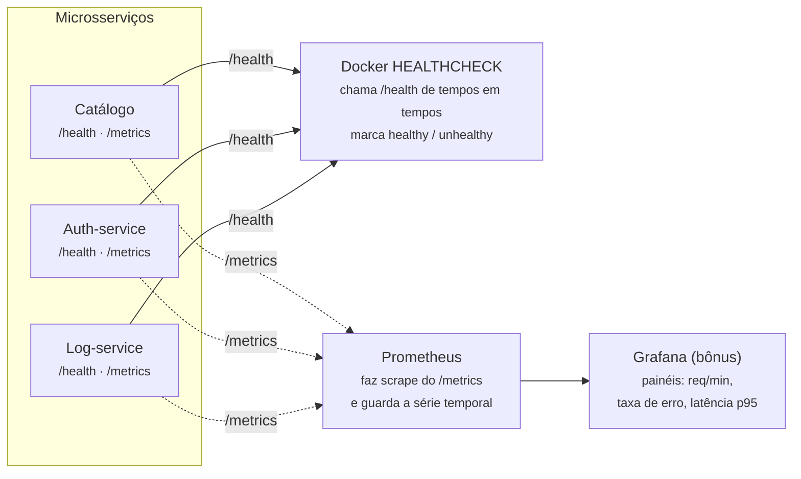

# Atividade extra: Observabilidade — health checks e métricas — Allan Siriani

**Fonte:** https://lapps.studio/disciplinas/introducao-computacao-nuvem/atividades/observabilidade-health-metricas/

[disciplinas](https://lapps.studio/) / [introdução à computação em nuvem](https://lapps.studio/disciplinas/introducao-computacao-nuvem/) / [atividades](https://lapps.studio/disciplinas/introducao-computacao-nuvem/atividades/) / observabilidade

ISW055 · Atividade extra

# Observabilidade — health checks e métricas

Na atividade 5 você registrou o que os usuários fazem. Falta o outro lado: como está a saúde dos próprios serviços — quem está no ar, quem está lento, quem está prestes a cair — sem precisar abrir um terminal pra descobrir.

**Prazo:** sem data de entrega  
*atividade extra · publicada 10/09/2026 · estende diretamente o log-service da atividade 5*

Um sistema em nuvem que você não consegue enxergar por dentro não é um sistema que você opera — é um sistema que você torce pra continuar funcionando. **Observabilidade** é o conjunto de sinais que um serviço emite sobre si mesmo, pra que dê pra responder "está saudável? está lento? por quê?" olhando de fora, sem entrar na máquina.

---

### Conceito

## Os três pilares — e você já tem um deles

- **Pilar 1 — feito na atividade 5**  
  **Logs**  
  Eventos discretos: "usuário X fez Y às Z". Respondem *o que aconteceu*. É o seu log-service com Redis.

- **Pilar 2 — esta atividade**  
  **Métricas**  
  Números ao longo do tempo: requisições por minuto, latência, taxa de erro. Respondem *como está agora e como está tendendo*.

- **Pilar 3 — só menção**  
  **Traces**  
  O caminho de uma requisição atravessando vários serviços. Vale saber que existe (OpenTelemetry), não é requisito aqui.

**Health check** é o sinal mais básico de todos — um endpoint `/health` que responde "estou bem?". Mas tem uma sutileza que separa quem entende de quem só copiou o tutorial: existem *dois* tipos de "bem".

**Liveness** — o processo está vivo e respondendo? Se não, o orquestrador reinicia o container. **Readiness** — eu consigo *realmente* atender? O banco responde? O Redis está acessível? Se não, o orquestrador para de mandar tráfego pra mim, mas não me reinicia (reiniciar não resolve o banco estar fora).

> **O erro mais comum:** um `/health` que sempre retorna `200`. Um container "no ar" que não consegue falar com o banco é *pior* que um container caído — o caído é óbvio, o outro fica silenciosamente devolvendo erro pra todo usuário. Readiness de verdade testa as dependências e retorna `503` quando alguma falha.

---

### Diagrama

## Quem consome cada sinal

> *Linhas cheias: o Docker consulta o `/health`. Linhas tracejadas: o Prometheus coleta o `/metrics`. São dois consumidores diferentes dos sinais que o mesmo serviço emite — e o Grafana só existe pra transformar a série temporal em algo que dá pra olhar.*

---

### Recursos

## Ferramentas

| Ferramenta | Papel |
| :--- | :--- |
| **HEALTHCHECK (Dockerfile / compose)** | Instrução nativa do Docker — aponta pro seu /health e faz o `docker ps` mostrar (healthy)/(unhealthy) |
| **prometheus-flask-exporter** | Adiciona /metrics num app Flask em poucas linhas, já no formato que o Prometheus lê |
| **Prometheus** | Container que coleta e guarda as métricas de todos os serviços — configura os alvos num YAML |
| **Grafana** | Container de painéis; conecta no Prometheus como fonte de dados — bônus, não obrigatório |

**Se algum serviço seu é FastAPI**, o equivalente é `prometheus-fastapi-instrumentator` — mesma ideia, mesmo formato de saída.

---

### Requisitos

## O que implementar

1. #### /health em cada serviço, com readiness de verdade
   Catálogo, auth-service, log-service e os demais que você tiver. O endpoint precisa testar as dependências reais daquele serviço (ping no MariaDB, no Redis, no MinIO — conforme o caso) e retornar `503` se alguma estiver fora. Um `/health` que sempre responde `200` não atende.

2. #### HEALTHCHECK no Docker
   Configure o `HEALTHCHECK` (no Dockerfile ou no compose) apontando pro `/health`, de modo que o `docker ps` mostre o status. Depois **prove que funciona**: derrube o Redis e mostre o log-service virando *unhealthy* sozinho, sem você tocar nele.

3. #### /metrics em pelo menos um serviço
   Exponha contagem de requisições por rota e código de status, e latência das requisições — `prometheus-flask-exporter` ou equivalente faz isso praticamente sozinho.

4. #### Bônus: Prometheus + Grafana no compose
   Suba os dois como containers da sua stack e monte um painel mínimo: requisições por minuto, taxa de erro (4xx/5xx) e latência p95. Não é obrigatório, mas é o que transforma "tenho um /metrics" em "consigo ver o sistema".

5. #### Provar
   Print do `docker ps` nos dois estados (tudo healthy, e log-service unhealthy com o Redis derrubado). Print do `/metrics` cru ou, se fez o bônus, do painel no Grafana.

---

### Entrega

## Continuar o mesmo repositório

- Continue no **mesmo repositório público do GitHub** das outras atividades
- Continue mencionando o professor no README: [github.com/siriani](https://github.com/siriani)
- Sem prazo fixo — mas só conta como entregue se os prints dos requisitos 2 e 5 estiverem no README até o fechamento das notas do semestre
- O `docker-compose.yml` atualizado com os HEALTHCHECKs (e com Prometheus/Grafana, se fez o bônus)

---

<footer>
  lapps.studio · ISW055 · atividade publicada 10/09/2026 · <a href="https://github.com/siriani">GitHub</a>
</footer>
