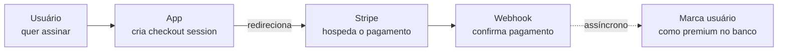

# Atividade: Plano Premium com Stripe — Allan Siriani

**Fonte:** https://lapps.studio/disciplinas/introducao-computacao-nuvem/atividades/plano-premium-stripe/

[disciplinas](https://lapps.studio/) / [introdução à computação em nuvem](https://lapps.studio/disciplinas/introducao-computacao-nuvem/) / [atividades](https://lapps.studio/disciplinas/introducao-computacao-nuvem/atividades/) / plano premium com stripe

ISW055 · Atividade 7 · Serviço baseado em pagamento

# Plano Premium — cobrança de verdade com Stripe

O catálogo ganha um modelo de negócio: um plano pago, cobrado de verdade (em modo de teste) por um provedor de pagamento — não uma senha de cartão guardada no seu próprio banco.

**Entrega:** sexta-feira, 09/10/2026  
*continuação direta da atividade 6 (upload e perfil)*

Até agora todo serviço construído resolvia um problema técnico. Este resolve um problema de **negócio**: como o sistema gera receita. E a resposta técnica de como cobrar não é "guardar o número do cartão" — é delegar isso pra um provedor especializado, porque dado de cartão é uma responsabilidade que praticamente nenhum sistema deveria carregar sozinho.

> **Modo de teste, sempre.** O Stripe tem um modo *test mode* completo, com cartões de teste que simulam pagamento aprovado/recusado sem mexer em dinheiro real. Toda a atividade — criação do plano, checkout, webhook — acontece em modo de teste. Nenhuma cobrança real deve existir nesta atividade.

---

### Conceito

## Por que pagamento é um serviço à parte

Guardar dado de cartão exige um nível de segurança e conformidade (PCI-DSS) que a esmagadora maioria dos sistemas nunca deveria tentar implementar sozinha. A solução do mercado: o próprio provedor de pagamento (Stripe, aqui) hospeda a página onde o cartão é digitado — seu sistema nunca vê o número do cartão, só recebe a confirmação de que o pagamento aconteceu.

Essa confirmação chega por **webhook**: o Stripe faz uma chamada HTTP pro seu backend quando o pagamento é concluído. É uma comunicação assíncrona — diferente de uma resposta direta a uma requisição, o webhook chega depois, quando o Stripe decidir mandar.

> *O app nunca processa o cartão diretamente — só cria a sessão e espera. A confirmação chega por um caminho separado (webhook), não como resposta direta da requisição que abriu o checkout.*

---

### Requisitos

## O que implementar

1. #### Criar o plano no Stripe (modo de teste)
   Um produto/preço no painel do Stripe — ex: "Plano Premium — R$ 9,90/mês". Use uma conta Stripe própria (gratuita) em modo de teste.

2. #### Endpoint de checkout
   Uma rota que cria uma *Checkout Session* do Stripe pro plano premium e redireciona o usuário logado pra lá.

3. #### Endpoint de webhook
   Uma rota que recebe a notificação do Stripe quando o pagamento é confirmado, e atualiza o usuário pra `premium: true` no banco. Valide a assinatura do webhook (o Stripe assina cada chamada — não aceite qualquer requisição que chegue nessa rota como se fosse legítima).

4. #### Um benefício real de quem é premium
   Escolha algo verificável — ex: favoritos ilimitados (se você limitou não-premium a N favoritos), ou um selo visível no perfil. O importante é existir uma diferença de comportamento comprovável entre usuário comum e premium, do mesmo jeito que a atividade 4 fez pra admin/usuario.

5. #### Nunca guarde dado de cartão
   Seu banco guarda, no máximo, o ID do cliente/assinatura do Stripe — nunca número de cartão, CVV ou validade. Isso nem chega no seu backend; fica só do lado do Stripe.

---

### Entrega

## Continuar o mesmo repositório

- Continue no **mesmo repositório público do GitHub** das atividades anteriores
- Continue mencionando o professor no README: [github.com/siriani](https://github.com/siriani)
- Print do checkout do Stripe em modo de teste sendo concluído com sucesso
- Print do usuário virando premium no banco depois do webhook, e do benefício premium funcionando

---

<footer>
  lapps.studio · ISW055 · atividade publicada 28/08/2026 · <a href="https://github.com/siriani">GitHub</a>
</footer>
