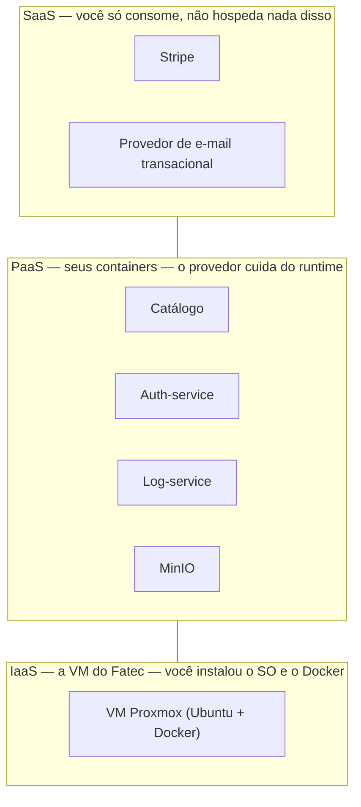

# Atividade: SaaS, PaaS, IaaS e documentação reversa — Allan Siriani

**Fonte:** https://lapps.studio/disciplinas/introducao-computacao-nuvem/atividades/saas-paas-iaas/

[disciplinas](https://lapps.studio/) / [introdução à computação em nuvem](https://lapps.studio/disciplinas/introducao-computacao-nuvem/) / [atividades](https://lapps.studio/disciplinas/introducao-computacao-nuvem/atividades/) / saas, paas e iaas

ISW055 · Atividade 8 · Encerramento do projeto

# SaaS, PaaS, IaaS — e a documentação que o projeto nunca teve

Última atividade da série: nenhuma linha de código nova. Em vez disso, você olha pra trás — pros últimos dois meses de commits — e documenta, do zero, o sistema que já existe. E entende, peça por peça, em qual camada de nuvem cada parte dele vive.

**Entrega:** sexta-feira, 16/10/2026  
*encerramento da série: agenda → catálogo → login → RBAC → logs → perfil → premium*

Toda atividade anterior pediu construir algo novo. Esta pede o oposto — e é, propositalmente, a parte do trabalho de um desenvolvedor que costuma incomodar mais: **documentar um sistema que já existe**, muitas vezes escrito por outra pessoa, sem documentação nenhuma. É praticamente garantido que isso vai acontecer no seu primeiro emprego: você vai herdar um sistema legado e vai ter que entender e registrar o que ele faz antes de poder mexer nele com segurança.

---

### Conceito

## SaaS, PaaS e IaaS — as três camadas de responsabilidade

As três siglas descrevem **quanto da pilha você gerencia versus quanto o provedor gerencia** por você:

- **IaaS — Infrastructure as a Service**  
  **Você gerencia o SO pra cima**  
  O provedor entrega máquina virtual, disco e rede. Você instala o sistema operacional, o Docker, tudo. Mais controle, mais responsabilidade.

- **PaaS — Platform as a Service**  
  **Você entrega só o código/imagem**  
  O provedor já cuida do SO, runtime e orquestração. Você só faz deploy da sua aplicação. Menos controle sobre a infraestrutura, mais velocidade.

- **SaaS — Software as a Service**  
  **Você só usa o produto pronto**  
  Nenhuma infraestrutura sua envolvida — você consome uma funcionalidade via API/painel de outra empresa, que cuida de tudo.

O seu projeto, hoje, já usa as três camadas ao mesmo tempo — sem que isso tenha sido chamado assim até agora. Essa é a parte que você vai mapear na atividade.

---

### Diagrama

## O seu projeto, camada por camada

> *O mesmo projeto atravessa as três camadas ao mesmo tempo: você administra o sistema operacional da VM (IaaS), faz deploy dos seus próprios containers nela sem se preocupar em reinstalar SO (efetivamente PaaS pro seu código) e delega pagamento/e-mail a produtos prontos de terceiros (SaaS).*

---

### Requisitos

## O que entregar

1. #### Classificação SaaS/PaaS/IaaS do seu próprio projeto
   No README, uma tabela ou lista curta apontando cada peça do sistema (VM, containers, Stripe, e-mail, qualquer outro serviço externo usado) e em qual camada ela se encaixa, com uma frase justificando cada uma.

2. #### Documentação reversa — Especificação
   O que o sistema faz, do ponto de vista de quem usa: cadastro/login, catálogo de filmes, favoritos, perfil, avatar, plano premium, logs de auditoria (pra admin). Escrito como se você tivesse acabado de herdar esse código de outra pessoa.

3. #### Documentação reversa — Arquitetura
   Um diagrama próprio (pode ser desenhado à mão, print de whiteboard digital, ou SVG/Mermaid) mostrando **todos** os serviços do sistema final: catálogo, auth-service, log-service + Redis, MinIO, integração Stripe — e como eles se conectam. É o "big picture" que nenhuma atividade anterior pediu isoladamente.

4. #### Documentação reversa — Regras de negócio
   Liste as regras que o código impõe hoje, na forma "se X, então Y" — ex: "usuário comum só edita o próprio perfil", "só admin apaga comentário de outro usuário", "usuário premium tem favoritos ilimitados", "link de redefinição de senha expira em 30min". Extraia isso lendo o código, não da memória.

5. #### Documentação reversa — Modelo de dados
   As tabelas/coleções principais e como se relacionam (usuário, filme, favorito, log, sessão premium). Pode ser um diagrama entidade-relacionamento simples.

> **Por que isso é a atividade mais importante da série.** Escrever código que funciona é metade do trabalho. A outra metade é deixar registrado, pra quem vier depois (inclusive você mesmo, daqui a 6 meses), como o sistema funciona e por quê. Um projeto sem documentação é um projeto que só uma pessoa consegue manter.

---

### Entrega

## Fechamento do repositório

- Continue no **mesmo repositório público do GitHub** de todas as atividades anteriores
- Continue mencionando o professor no README: [github.com/siriani](https://github.com/siriani)
- Toda a documentação reversa (especificação, arquitetura, regras de negócio, modelo de dados) fica num arquivo próprio — sugestão: `DOCUMENTACAO.md` — linkado a partir do README principal
- O README principal ganha a seção de classificação SaaS/PaaS/IaaS do projeto

---

<footer>
  lapps.studio · ISW055 · atividade publicada 28/08/2026 · <a href="https://github.com/siriani">GitHub</a>
</footer>
