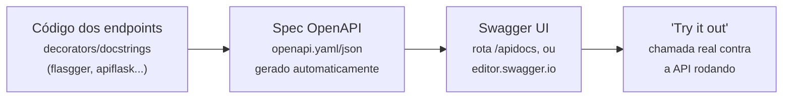

# Atividade extra: Documentação Swagger/OpenAPI — Allan Siriani

**Fonte:** https://lapps.studio/disciplinas/introducao-computacao-nuvem/atividades/documentacao-swagger/

[disciplinas](https://lapps.studio/) / [introdução à computação em nuvem](https://lapps.studio/disciplinas/introducao-computacao-nuvem/) / [atividades](https://lapps.studio/disciplinas/introducao-computacao-nuvem/atividades/) / documentação swagger

ISW055 · Atividade extra

# Documentando suas APIs com Swagger/OpenAPI

Todo serviço que você construiu neste semestre já tem um contrato — método, rota, parâmetros, formato de resposta. Esse contrato só existe hoje dentro do seu código. Esta atividade é sobre deixá-lo visível e testável por qualquer pessoa, sem precisar ler uma linha do seu Python.

**Prazo:** sem data de entrega  
*atividade extra · publicada 10/09/2026 · vale como plus, não substitui nenhuma atividade obrigatória*

Diferente das outras atividades da disciplina, esta não tem data de corte. Ela existe porque, a essa altura do semestre, você já construiu API suficiente (catálogo, auth-service, log-service, upload, e possivelmente o checkout do Stripe) pra valer a pena parar e documentar tudo de um jeito padronizado — a mesma prática que qualquer equipe de verdade usa antes de outro time (ou outro serviço seu) começar a consumir sua API.

---

### Conceito

## OpenAPI é a especificação, Swagger é a ferramenta

**OpenAPI** é um formato padrão (YAML ou JSON) pra descrever uma API REST: toda rota, todo método HTTP, todo parâmetro, o formato exato do corpo esperado na requisição e de cada resposta possível — incluindo os códigos de erro. **Swagger UI** é a ferramenta mais popular que lê esse arquivo e renderiza uma página interativa, onde dá pra expandir cada endpoint, ver exemplos, e literalmente **chamar a API de verdade** direto do navegador, clicando em "Try it out".

A diferença entre isso e um `README.md` explicando os endpoints à mão: o arquivo OpenAPI é **lido por máquina**. É o mesmo arquivo que alimenta geração automática de client SDK, validação de contrato entre serviços, e — no caso desta atividade — permite que eu (ou qualquer colega seu) teste sua API sem precisar rodar seu projeto do zero pra entender o que ela faz.

---

### Diagrama

## Do código à chamada real pelo navegador

> *A spec não é escrita à mão do zero — as bibliotecas de Swagger pra Flask geram ela a partir de anotações direto no código dos seus endpoints, então documentar não significa duplicar trabalho, só descrever o que já existe.*

---

### Recursos

## Ferramentas pra gerar a spec

| Ferramenta | Quando usar |
| :--- | :--- |
| **flasgger** | Mais simples de plugar num app Flask já existente — docstring em YAML dentro da própria função da rota |
| **apiflask** | Mais moderno, integra com validação via schemas (marshmallow) — vale se você quiser ir além do mínimo |
| **Flask-RESTX** | Alternativa mais antiga e ainda comum, baseada em classes de recurso |
| **editor.swagger.io** | Se preferir escrever a spec à mão (YAML puro) em vez de gerar via biblioteca — cole o arquivo e já visualiza |

**Se algum serviço seu já é FastAPI** em vez de Flask, essa atividade sai quase de graça: o FastAPI gera a spec OpenAPI automaticamente, sem biblioteca extra, e já expõe Swagger UI pronto na rota `/docs`.

---

### Requisitos

## O que documentar

1. #### Escolher pelo menos 2 dos seus serviços
   Catálogo, auth-service, log-service, upload/perfil, ou o endpoint de checkout/webhook do Stripe — o que você já tiver construído até agora. Não precisa ser todos, mas quanto mais completo, melhor.

2. #### Documentar cada endpoint por completo
   Método HTTP, rota, parâmetros esperados, corpo da requisição, e todas as respostas possíveis com exemplo de payload — incluindo os códigos de erro (`400`, `401`/`403`, etc), não só o caminho de sucesso.

3. #### Publicar de um jeito acessível
   Swagger UI embutido na própria aplicação (rota tipo `/apidocs`) é o ideal. Se não der tempo de integrar, o arquivo `openapi.yaml`/`.json` no repositório também vale — dá pra visualizar colando em editor.swagger.io.

4. #### Provar que funciona de verdade
   Print do Swagger UI com pelo menos um endpoint expandido e o "Try it out" executado — uma chamada real, com resposta real da sua API rodando, não só a tela vazia da documentação.

---

### Entrega

## Continuar o mesmo repositório

- Continue no **mesmo repositório público do GitHub** das outras atividades
- Continue mencionando o professor no README: [github.com/siriani](https://github.com/siriani)
- Sem prazo fixo — mas só conta como entregue se o link do Swagger (ou o arquivo da spec) estiver referenciado no README até o fechamento das notas do semestre
- Print do Swagger UI com um endpoint testado (requisito 4)

---

<footer>
  lapps.studio · ISW055 · atividade publicada 10/09/2026 · <a href="https://github.com/siriani">GitHub</a>
</footer>
