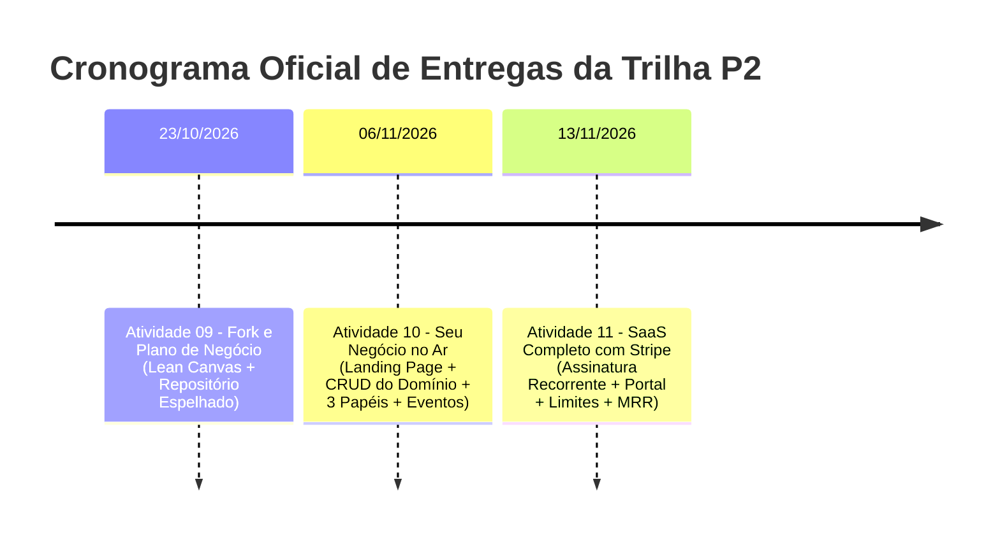
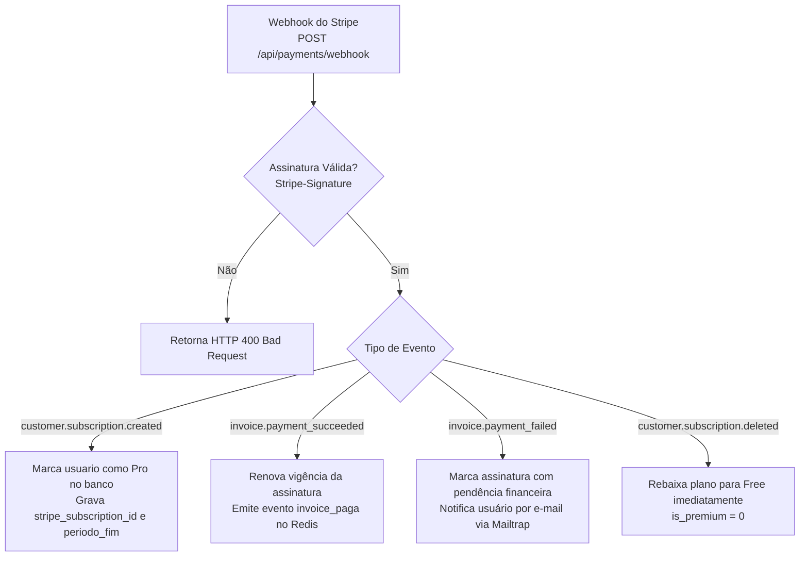

# Plano Geral de Implementação — Trilha SaaS P2 (ISW055)

> **Disciplina:** ISW055 — Arquitetura de Microsserviços e Aplicações em Cloud  
> **Docente:** Prof. Flávio Siriani ([@siriani](https://github.com/siriani))  
> **Estudante:** Gabriel Roberto de Assis  
> **Repositório Origem (P1):** [github.com/Gabriel-Assis-22/Atividade_02_Claude](https://github.com/Gabriel-Assis-22/Atividade_02_Claude)  
> **Subdomínio de Produção:** `https://gabriel-assis-isw055.lapps.studio`

---

## 🎯 Visão Geral da Trilha P2

A segunda metade da disciplina consiste em **transformar a arquitetura completa desenvolvida no primeiro bimestre em um produto de software real como serviço (SaaS)**. O catálogo cinematográfico de Tom Hanks dá lugar a uma plataforma comercial com dor de negócio tangível, cobrança recorrente via Stripe, múltiplos papéis e isolamento rigoroso de inquilinos.

A evolução ocorre em 3 etapas consecutivas:



---

## 💡 Definição do Produto SaaS: **UniRide (Carona Universitária Compartilhada)**

Alinhado às dores sugeridas no enunciado oficial da disciplina, o produto escolhido para ser construído sobre a nossa arquitetura é o **UniRide**:

* **A Dor Real:** Estudantes universitários que residem em cidades vizinhas (ex.: Marília, Bauru, Garça, Pompeia) gastam quantias elevadas com passagens de ônibus e perdem até 3 horas diárias aguardando itinerários precários, enquanto centenas de alunos transitam diariamente de carro com assentos vazios por falta de uma plataforma centralizada e segura de caronas no campus.
* **A Solução:** Plataforma SaaS que conecta condutores universitários a passageiros do mesmo campus, com rotas pré-definidas, divisão de custos, validação de vínculo institucional, upload de comprovantes/veículos e planos por assinatura.

---

# 📦 PARTE 1 — Planejamento da Atividade 09: Fork e Plano de Negócio
> **Prazo:** Sexta-feira, 23/10/2026  
> **Arquivo de Referência:** [Atividade_09_ForkPlanoNegocio.md](file:///c:/Users/gabri/Documents/GitHub/Atividade_02_Claude/.antigravity/Atividade_09_ForkPlanoNegocio.md)

### 1.1. O que existe no projeto atual (P1)
- Repositório Git consolidado com histórico desde agosto/2026 (`Atividade_02_Claude`).
- Documentação de P1 (`docs/P1_ISW055_Gabriel_Assis.pdf`), especificação reversa (`DOCUMENTACAO.md`) e classificação SaaS/PaaS/IaaS no `README.md`.
- Stack conteinerizada funcional (.NET 10 DDD, Angular 19, MariaDB, Redis Streams, Garage S3, Auth com BCrypt e Stripe Checkout).

### 1.2. Projeto de Implementação

#### Etapa 1.1: Espelhamento Oficial do Repositório (Bare Mirror)
1. Criar novo repositório público vazio no GitHub: `github.com/Gabriel-Assis-22/UniRide_SaaS`.
2. Executar espelhamento com histórico integral preservado:
   ```bash
   git clone --bare https://github.com/Gabriel-Assis-22/Atividade_02_Claude.git
   cd Atividade_02_Claude.git
   git push --mirror https://github.com/Gabriel-Assis-22/UniRide_SaaS.git
   cd ..
   rm -rf Atividade_02_Claude.git
   ```
3. No repositório original (`Atividade_02_Claude`), adicionar no topo do `README.md`:
   ```markdown
   > 🚀 **Este projeto continua em:** [github.com/Gabriel-Assis-22/UniRide_SaaS](https://github.com/Gabriel-Assis-22/UniRide_SaaS)
   ```

#### Etapa 1.2: Elaboração do README do Produto com Lean Canvas (8 Blocos)
Substituir o README do repositório novo pelos 8 blocos na ordem estrita:
1. **Nome e Frase de Impacto:** *UniRide — Caronas universitárias seguras, econômicas e inteligentes entre cidades do interior paulista.*
2. **A Dor Específica:** O custo mensal de transporte intermunicipal supera R$ 400 por aluno, com horários engessados e risco nos pontos de embarque noturnos.
3. **Persona:** *Lucas, 21 anos*, cursa DSM na Fatec, mora em Marília e viaja 45 km diários. *Camila, 24 anos*, vai de carro todos os dias e gasta R$ 600 de combustível mensal sozinha.
4. **Concorrentes e Alternativas Atuais:** Grupos informais de WhatsApp/Telegram (desorganizados e inseguros), ônibus rodoviários (caros e lentos) e BlaBlaCar (foco em viagens interestaduais, sem validação universitária).
5. **Proposta de Valor:** Caronas exclusivas entre universitários validados, reserva instantânea de assentos, rotas recorrentes e divisão simplificada de despesas.
6. **Modelo de Receita com Stripe:** Plano Gratuito (Passageiro: até 2 reservas simultâneas) vs **Plano UniRide Pro (R$ 14,90/mês)** com reservas ilimitadas, alertas prioritários e selo de motorista verificado.
7. **Métricas de Sucesso (KPIs):** Total de viagens cadastradas/mês, taxa de ocupação de assentos (>70%), retenção mensal (churn < 5%) e MRR (Receita Recorrente Mensal).
8. **Lean Canvas (9 Blocos Estruturados):**
   - Problema
   - Segmentos de Clientes
   - Proposta Única de Valor
   - Solução
   - Canais
   - Fontes de Receita
   - Estrutura de Custos
   - Métricas-Chave
   - Vantagem Injusta

#### Etapa 1.3: Mapa de Reaproveitamento de Componentes
Tabela formal mapeando a transição de cada componente do sistema:

| Componente Atual (Filmes) | O que Vira no Novo SaaS (UniRide) | Justificativa Técnica |
| :--- | :--- | :--- |
| **Catálogo TMDB** | **Feed e Busca de Caronas Universitárias** | Substituição da listagem de filmes por viagens disponíveis (origem, destino, data/hora, assentos livres). |
| **Favoritos / Comentários** | **Caronas Salvas & Avaliações de Condutores** | Persistência relacional reaproveitada para salvar rotas preferidas e deixar feedbacks entre condutor e caronista. |
| **`auth-service` (JWT + Roles)** | **Identidade com 3 Papéis: Passageiro, Motorista e Admin** | Extensão das claims do JWT para diferenciar permissões operacionais e moderação. |
| **`log-service` (Redis Streams)** | **Trilha de Eventos de Caronas e Segurança** | Registro de `carona_criada`, `reserva_solicitada`, `reserva_cancelada` e auditoria de pagamentos. |
| **Garage S3 Storage** | **Upload de CNH, Foto do Veículo e Avatar** | Armazenamento seguro de imagens de verificação de segurança dos condutores e fotos de perfil. |
| **Stripe Checkout & Webhooks** | **Assinatura do Plano UniRide Pro** | Checkout recorrente para motoristas parceiros e passageiros frequentes com validação de webhook. |

---

# 🚀 PARTE 2 — Planejamento da Atividade 10: Seu Negócio no Ar
> **Prazo:** Sexta-feira, 06/11/2026  
> **Arquivo de Referência:** [Atividade_10_DominioNoAr.md](file:///c:/Users/gabri/Documents/GitHub/Atividade_02_Claude/.antigravity/Atividade_10_DominioNoAr.md)

### 2.1. O que existe no projeto atual (P1)
- Backend .NET com controllers de filmes e favoritos.
- Frontend Angular com páginas de catálogo, perfil e login.
- Migrações FluentMigrator configuradas no MariaDB remoto.

### 2.2. Projeto de Implementação

#### Etapa 2.1: Modelagem e Migrações do Domínio UniRide (MariaDB)
Criar migrations FluentMigrator adicionando as tabelas centrais:
- `veiculos` (`id`, `usuario_id`, `modelo`, `placa`, `cor`, `foto_url`, `criado_em`)
- `caronas` (`id`, `motorista_id`, `cidade_origem`, `cidade_destino`, `ponto_encontro`, `data_hora_saida`, `vagas_totais`, `vagas_disponiveis`, `valor_contribuicao`, `status`, `criado_em`)
- `reservas` (`id`, `carona_id`, `passageiro_id`, `status` [pendente, confirmada, cancelada], `criado_em`)
- `avaliacoes` (`id`, `carona_id`, `avaliador_id`, `avaliado_id`, `nota`, `comentario`, `criado_em`)

#### Etapa 2.2: Endpoints da API do Domínio (`backend`)
Substituir controllers de catálogo por:
- `GET /api/caronas` (Busca com filtros de cidade origem, destino e data).
- `POST /api/caronas` (Apenas papel `motorista` pode cadastrar caronas).
- `GET /api/caronas/{id}` (Detalhes, vagas e perfil do motorista).
- `POST /api/caronas/{id}/reservar` (Passageiro reserva assento; decrementa vagas atomicamente).
- `DELETE /api/caronas/{id}` (Cancelamento pelo motorista ou moderação pelo Admin).
- `GET /api/minhas-caronas` e `GET /api/minhas-reservas` (Isolamento rigoroso por usuário autenticado).

#### Etapa 2.3: Configuração de 3+ Papéis (*Roles*) no `auth-service`
1. Papéis suportados:
   - `passageiro` (solicita caronas, salva rotas, edita próprio perfil).
   - `motorista` (cadastra veículos, publica caronas, aceita/recusa reservas).
   - `admin` (modera caronas, cancela rotas com denúncia, audita logs).
2. Validação de claims no JWT e restrição nos controllers via `[Authorize(Roles = "...")]`.

#### Etapa 2.4: Landing Page Pública e Interface SPA (Angular 19)
1. **Landing Page:**
   - Hero com busca rápida: *"De onde? Para onde? Quando?"*.
   - Exibição de benefícios, economia mensal estimada e depoimentos simulados.
   - Tabela de preços clara (Free vs Pro).
   - Botões de chamada para ação (CTA): *"Buscar Carona"* e *"Oferecer Carona"*.
2. **Área Autenticada:**
   - Feed de caronas disponíveis com card de condutor e vagas.
   - Painel do motorista (cadastro de veículo e publicação de rotas).
   - Painel do passageiro (minhas reservas ativas).

#### Etapa 2.5: Eventos de Negócio no `log-service` (Redis Streams)
Disparo de eventos auditáveis com estrutura JSON no Redis:
- `carona_publicada` (`motorista_id`, `origem`, `destino`, `vagas`)
- `reserva_criada` (`passageiro_id`, `carona_id`, `vagas`)
- `reserva_cancelada` (`usuario_id`, `carona_id`, `motivo`)
- `tentativa_idor_bloqueada` (se usuário tentar alterar carona de outro condutor)

#### Etapa 2.6: Upload de Mídia no Storage Garage S3
- Upload de foto do veículo e documento do motorista armazenados no bucket `uniride-media`.
- Entrega com proxy e cache Nginx via `/storage/`.

---

# 💳 PARTE 3 — Planejamento da Atividade 11: SaaS Completo com Stripe
> **Prazo:** Sexta-feira, 13/11/2026 (mesmo dia da avaliação P2)  
> **Arquivo de Referência:** [Atividade_11_SaasCompletoStripe.md](file:///c:/Users/gabri/Documents/GitHub/Atividade_02_Claude/.antigravity/Atividade_11_SaasCompletoStripe.md)

### 3.1. O que existe no projeto atual (P1)
- Checkout único de pagamento no Stripe (`mode: 'payment'`).
- Webhook capturando `checkout.session.completed`.
- Campo `is_premium` e `stripe_customer_id` na tabela `usuarios`.

### 3.2. Projeto de Implementação

#### Etapa 3.1: Configuração de Planos Recorrentes no Stripe Dashboard (Test Mode)
Criar dois planos mensais recorrentes:
1. **Plano Gratuito (Free):** R$ 0,00/mês — Limite de até **2 reservas de carona ativas simultâneas** ou 1 publicação por semana.
2. **Plano UniRide Pro (R$ 14,90/mês):** Assinatura mensal recorrente (`mode: 'subscription'`) — Reservas e publicações ilimitadas, selo de verificação de motorista e destaque visual nas buscas.

#### Etapa 3.2: Endpoint de Checkout de Assinatura
No `PaymentsController.cs`:
- Modificar criação de sessão para `Mode = "subscription"`.
- Associar `PriceId` do plano cadastrado no Stripe.
- Passar `CustomerEmail`, `ClientReferenceId = usuario.Id` e metadata contextual.

#### Etapa 3.3: Webhook Completo de Ciclo de Vida de Assinaturas
Implementar tratamento robusto para os eventos essenciais do Stripe:



#### Etapa 3.4: Integração com o Stripe Customer Portal
Criar endpoint `POST /api/payments/customer-portal`:
- O Stripe oferece o **Customer Portal** pronto, onde o cliente pode atualizar cartão, visualizar notas fiscais ou cancelar a assinatura sem intervenção da equipe.
- O backend invoca `Stripe.BillingPortal.SessionService.CreateAsync()` com o `stripe_customer_id` do usuário e retorna a URL segura para redirecionamento.

#### Etapa 3.5: Enforcement de Limites do Plano na API
Implementar verificação rigorosa nos Use Cases do backend:
```csharp
// Exemplo em CriarReservaCaronaUseCase.cs
var usuario = await usuarioRepo.GetByIdAsync(passageiroId);
if (!usuario.IsPremium)
{
    var reservasAtivas = await reservaRepo.ContarAtivasPorUsuarioAsync(passageiroId);
    if (reservasAtivas >= 2)
    {
        throw new BusinessRuleException(
            "Limite de 2 reservas simultâneas atingido para o plano gratuito. Assine o UniRide Pro para reservas ilimitadas!", 
            requerUpgrade: true);
    }
}
```

#### Etapa 3.6: Painel Administrativo de Métricas de Negócio (MRR / Churn)
Criar endpoint e tela administrativa exibindo:
- **MRR (Monthly Recurring Revenue):** Cálculo `total_assinantes_ativos * valor_mensal`.
- **Total de Usuários Free vs Pro.**
- **Log de transações recentes aprovadas e falhas de renovação.**

---

## 🛠️ Resumo das Entregas e Checklist de Execução

```markdown
- [ ] **Atividade 09 (23/10/2026):**
  - [ ] Criar repositório público vazio `UniRide_SaaS` no GitHub.
  - [ ] Executar espelhamento bare mirror com 100% dos commits preservados.
  - [ ] Adicionar apontamento no topo do README original do catálogo.
  - [ ] Elaborar README completo do UniRide com os 8 blocos + Lean Canvas + Mapa de Reaproveitamento.

- [ ] **Atividade 10 (06/11/2026):**
  - [ ] Migrations das entidades de negócio (`caronas`, `veiculos`, `reservas`).
  - [ ] Implementação dos controllers e use cases de carona.
  - [ ] Suporte aos papéis `passageiro`, `motorista` e `admin` no auth-service.
  - [ ] Landing page pública com proposta de valor e busca.
  - [ ] Upload de veículos/documentos no Garage S3.
  - [ ] Trilha de eventos no Redis Streams.
  - [ ] Deploy da nova versão no Portainer mantendo a mesma infraestrutura e subdomínio.

- [ ] **Atividade 11 (13/11/2026 - P2):**
  - [ ] Planos Free e Pro configurados no Stripe.
  - [ ] Checkout no modo `subscription`.
  - [ ] Webhooks para ciclo de vida (criação, renovação, falha, cancelamento).
  - [ ] Endpoint e botão para o Stripe Customer Portal.
  - [ ] Enforcement de limite de reservas na API (HTTP 403 Forbidden).
  - [ ] Painel com MRR e contagem de assinantes ativos.
```
