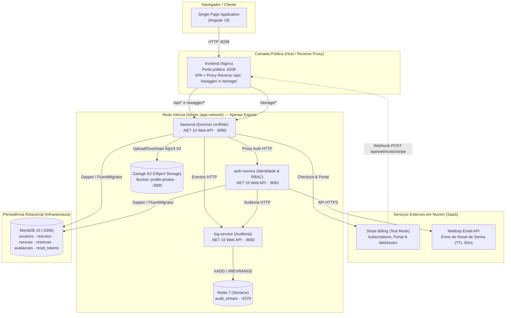
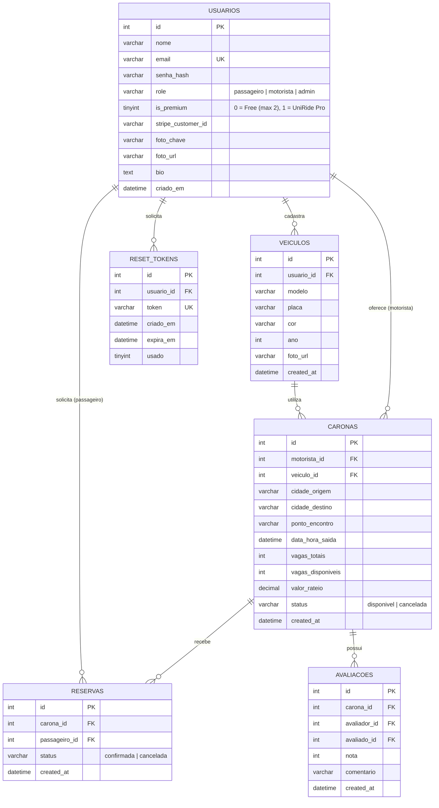

# Documentação Reversa do Sistema — UniRide SaaS (Carona Universitária Compartilhada)

> **ISW055 · Introdução à Computação em Nuvem · Fatec Pompeia · 2026.2**  
> **Professor:** [@siriani](https://github.com/siriani)  
> **Aluno:** Gabriel Roberto de Assis  
> **Repositório do Produto:** [github.com/Gabriel-Assis-22/Atividade_03_Claude](https://github.com/Gabriel-Assis-22/Atividade_03_Claude)

---

## 1. Especificação Funcional (Visão do Usuário)

Esta especificação descreve o comportamento completo do sistema **UniRide SaaS** do ponto de vista de quem o opera e utiliza, concebida como guia técnico de manutenção e evolução do software.

### 1.1. Gestão de Identidade e Acesso (RBAC)
- **Cadastro de Usuário:** Qualquer estudante ou condutor acadêmico pode criar uma conta fornecendo Nome, E-mail válido, Senha (com hash criptográfico BCrypt) e selecionando seu papel inicial (`passageiro` ou `motorista`). O usuário recém-criado inicia no plano gratuito (`is_premium: false`).
- **Autenticação (Login):** Autenticação stateless via credenciais (E-mail e Senha) processada pelo microsserviço desacoplado `auth-service`. Retorna um token JWT assinado simetricamente (HMAC-SHA256), contendo claims de `userId`, `email`, `role` e `isPremium`.
- **Recuperação de Senha:** O usuário informa seu e-mail e recebe um link com token criptográfico de uso único com validade estrita de **30 minutos** via Mailtrap.
- **Níveis de Privilégio (3 Papéis do Negócio):**
  - **Passageiro (`passageiro`):** Pesquisa rotas disponíveis por origem, destino e data; solicita e cancela suas próprias reservas; edita seu perfil e assina o Plano UniRide Pro.
  - **Motorista (`motorista`):** Possui todas as permissões de passageiro e pode cadastrar veículos (com upload de foto no Garage S3), publicar novas rotas de carona e gerenciar suas viagens.
  - **Administrador (`admin`):** Possui permissão para auditar a trilha de eventos do Redis Streams (`GET /api/logs`), consultar indicadores financeiros de MRR (`GET /api/assinaturas/metricas`) e moderar recursos.

### 1.2. Domínio de Mobilidade Universitária (Veículos, Caronas e Reservas)
- **Landing Page Pública:** Página aberta sem necessidade de login apresentando a proposta de valor universitária, busca rápida de rotas e tabela comparativa dos planos Free vs. Pro.
- **Feed e Busca de Caronas:** Listagem de viagens com status `disponivel`, exibindo condutor, veículo, cidade de origem, destino, ponto de encontro, horário de saída, assentos livres e valor do rateio.
- **Reserva Atômica de Assentos:** Confirmação de vaga com decremento condicional atômico no banco (`vagas_disponiveis > 0`), impedindo *overbooking*, auto-reserva pelo próprio motorista e reservas duplicadas do mesmo passageiro.

### 1.3. Monetização Recorrente (Planos e Assinatura com Stripe)
- **Plano Passageiro Free (R$ 0,00/mês):** Permite buscar caronas livremente e manter até **2 reservas ativas simultâneas**. Ao tentar solicitar uma 3ª reserva ativa, a API bloqueia a operação com `HTTP 403 Forbidden` (`codigo: "LIMITE_PLANO_FREE"`) e exibe um CTA de upgrade na interface.
- **Plano UniRide Pro (R$ 14,90/mês):** Assinatura mensal recorrente (`mode: "subscription"`) processada via **Stripe Checkout** (em modo de teste). Desbloqueia **reservas ilimitadas** e acesso ao **Stripe Customer Portal** para autogestão de cartão, faturas e cancelamento.
- **Ciclo de Vida via Webhooks:** Webhooks assinados criptograficamente (`Stripe-Signature`) processam `checkout.session.completed`, `customer.subscription.created`, `customer.subscription.updated` e `customer.subscription.deleted` de maneira idempotente no MariaDB.
- **Conformidade PCI-DSS:** Nenhum dado de cartão, validade ou CVC transita ou é armazenado no servidor; apenas o `stripe_customer_id` é vinculado ao usuário.

### 1.4. Armazenamento de Objetos S3 e Trilha de Auditoria
- **Upload no Garage S3:** Fotos de veículos e avatares de perfil são armazenados no bucket S3 via assinatura AWS Signature Version 4 (SigV4) e servidos por proxy reverso na rota `/storage/`.
- **Auditoria em Redis Streams:** Eventos de negócio e segurança (`carona_criada`, `reserva_solicitada`, `reserva_cancelada`, `bloqueio_limite_plano`, `bloqueio_seguranca`, `webhook_stripe_sucesso`) são gravados de forma *append-only* no stream `audit_stream`.

---

## 2. Arquitetura do Sistema (Big Picture)

---

## 3. Regras de Negócio (Extraídas Diretamente do Código-Fonte)

| Código | Condição (SE) | Consequência (ENTÃO) | Arquivo Fonte |
| :---: | :--- | :--- | :--- |
| **RN01** | Usuário submete cadastro com e-mail já existente | Operação é rejeitada com HTTP `400 Bad Request` | `auth-service/.../AuthUseCases.cs` |
| **RN02** | Usuário solicita login com credenciais inválidas | Retorna HTTP `401 Unauthorized` e grava `login_falha` no Redis Streams | `auth-service/.../AuthUseCases.cs` |
| **RN03** | Token de redefinição de senha é solicitado | Gera token criptográfico com expiração de **30 minutos** e envia via Mailtrap | `auth-service/.../AuthUseCases.cs` |
| **RN04** | Usuário com papel `passageiro` tenta cadastrar veículo ou publicar carona | Requisição é barrada pelo middleware RBAC com HTTP `403 Forbidden` | `backend/.../VeiculosController.cs` / `CaronasController.cs` |
| **RN05** | Motorista tenta cadastrar carona informando `veiculoId` que pertence a outro usuário | Operação é bloqueada com HTTP `403 Forbidden` (Anti-IDOR) e registrada no log | `backend/.../CaronaUseCases.cs` |
| **RN06** | Usuário tenta cancelar carona ou reserva pertencente a terceiros | O backend rejeita a mutação com HTTP `403 Forbidden` e emite `bloqueio_seguranca` | `backend/.../CaronaUseCases.cs` / `ReservaUseCases.cs` |
| **RN07** | Passageiro no plano Free (`is_premium = 0`) com 2 reservas confirmadas tenta criar a 3ª reserva | Operação bloqueada com HTTP `403 Forbidden` (`LIMITE_PLANO_FREE`) e evento `bloqueio_limite_plano` | `backend/.../ReservaUseCases.cs` |
| **RN08** | Passageiro no plano UniRide Pro (`is_premium = 1`) solicita novas reservas | Ação permitida sem limite mensal de reservas | `backend/.../ReservaUseCases.cs` |
| **RN09** | Passageiro reserva vaga em carona disponível | Decrementa `vagas_disponiveis` de forma atômica no MariaDB e impede duplicidade (`uk_reserva_carona_passageiro`) | `backend/.../ReservaRepository.cs` |
| **RN10** | Webhook do Stripe chega com `Stripe-Signature` válido | Atualiza `is_premium` (`1` em criação/renovação; `0` em `customer.subscription.deleted`) de forma idempotente | `backend/.../PaymentUseCases.cs` |
| **RN11** | Usuário sem papel `admin` tenta consultar `/api/logs` ou `/api/assinaturas/metricas` | Requisição recusada com HTTP `403 Forbidden` | `backend/.../LogsController.cs` / `PaymentsController.cs` |

---

## 4. Modelo de Dados (DER Relacional)

